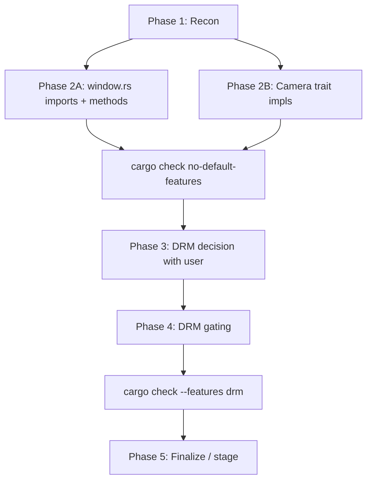

Plan: Resolve Remaining Merge Issues

Based on `context.md`, the merge is partially resolved with ~20 build errors remaining. Here's a structured plan to get a clean non-DRM build, then chart the path for DRM.

## Phase 1 — Reconnaissance (parallel, read-only)

Before editing, verify current state to avoid surprises:

1. **Confirm merge state & unresolved files**: `git status` + `git diff --check` to find any remaining conflict markers.
2. **Diagnostics snapshot**: `cargo check --lib --no-default-features` and capture the full error list (not just the summary in `context.md`).
3. **Audit `src/window/window_common.rs`**: list every `impl Window` method to know exactly what needs porting to `window.rs` (Todo A).
4. **Audit camera files**: grep for `<<<<<<<` markers and `fn handle_event`/`fn update` signatures across all 6 camera files (Todo B).

## Phase 2 — Fix Non-DRM Build (Todos A & B)

These can run **in parallel** since their write scopes are disjoint (`src/window/window.rs` vs `src/camera/*.rs`).

### Todo A — `src/window/window.rs` (window/offscreen/events compile)
1. Re-add missing imports lost when upstream's import block was taken:
   - `std::rc::Rc`, `std::cell::RefCell`
   - `std::sync::mpsc::Receiver`
   - `crate::window::CanvasInputState`
   - Anything else flagged by E0425/E0433.
2. Port methods currently only on `window_common::Window`:
   - `close()`
   - `set_background_color()`
   - Any others discovered in Phase 1 step 3 that are called from `events.rs` / `offscreen.rs` / public API.
3. Resolve the borrow-checker issues (E0502, E0596, E0308) — these are likely fallout from interleaved upstream/HEAD code in `rendering.rs`/`offscreen.rs`; address once imports & methods are in.

### Todo B — Camera trait impls (`src/camera/*.rs`)
For each of: `sidescroll2d.rs`, `orbit3d.rs`, `first_person3d.rs`, `first_person_stereo3d.rs`, `fixed_view3d.rs`, `camera3d.rs`:
1. Resolve any leftover `<<<<<<< ======= >>>>>>>` markers.
2. Apply the **same pattern as `fixed_view2d.rs`**:
   - Keep HEAD's `&CanvasInputState<'_>` signatures on `handle_event`/`update`.
   - Adopt upstream's body improvements, swapping `canvas.scale_factor()` → `input.scale_factor`, etc.
3. Verify trait definitions in `src/camera/{camera2d,camera3d}.rs` still use `&CanvasInputState<'_>` (per context, they do — but double-check `camera3d.rs` is listed in the error file list, so its trait may have drifted).

### Validation gate
Run `cargo check --lib --no-default-features` after each todo. Target: **0 errors**. Then `cargo check --all-targets --no-default-features` to catch example/test breakage.

## Phase 3 — DRM Strategy Decision (discuss with user)

The DRM feature is architecturally orphaned: `window_common::Window` lacks all the new rendering fields (`hdr`, `shadow_mapper`, `ssao`, `clustered`, …) that `rendering.rs` references unconditionally. Need to pick one:

| Option | Effort | Tradeoff |
|---|---|---|
| **A. Drop DRM** | Lowest | Loses the FLimburg fork's headless capability |
| **B. Gate advanced effects behind `#[cfg(not(feature = "drm"))]`** | Medium | Two divergent render paths; DRM stays minimal but maintained |
| **C. Unify**: add full pipeline to `window_common::Window`, abstract `DrmSurfaceTexture`/`SurfaceTexture` behind a trait | High | Clean long-term; biggest refactor |

**Recommendation**: Option **B** for now — it keeps DRM alive without committing to the unification work, and matches the existing `#[cfg]`-gated structure. Revisit C only if DRM consumers actually need the new effects.

## Phase 4 — DRM Build Fix (after decision)

If **B** is chosen:
1. Wrap unconditional uses of `hdr`/`shadow_mapper`/`ssao`/etc. in `src/window/rendering.rs` (and any other consumer) with `#[cfg(not(feature = "drm"))]`.
2. Address the 6 DRM-specific errors at `rendering.rs:1174,1195,1416,1434,1475,1496` (`wgpu::SurfaceTexture` vs `DrmSurfaceTexture`) — likely by introducing small helper functions per backend or `#[cfg]` branches around the present/readback paths.
3. Validate: `cargo check --lib --features drm --no-default-features`.

## Phase 5 — Finalize

1. `cargo check --all-targets` for both default and `drm` feature sets.
2. `cargo test --lib` (smoke; don't fix unrelated failures per instructions).
3. Review `git diff --stat` against `upstream/master` to confirm no upstream files were accidentally regressed.
4. Stage the resolved files; **do not commit** — leave `git merge --continue` for the user.

## Execution Order

**Parallelization opportunities**: Phase 1 reads in parallel; Phase 2A and 2B in parallel (disjoint write scopes — could even be delegated to two sub-agents).
